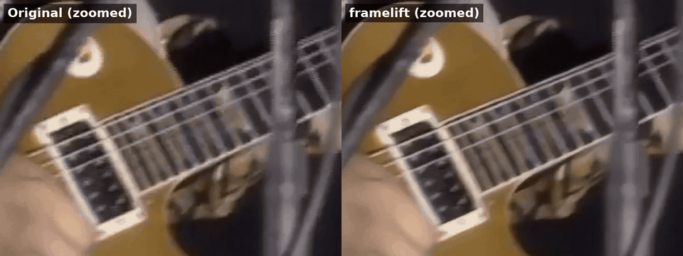
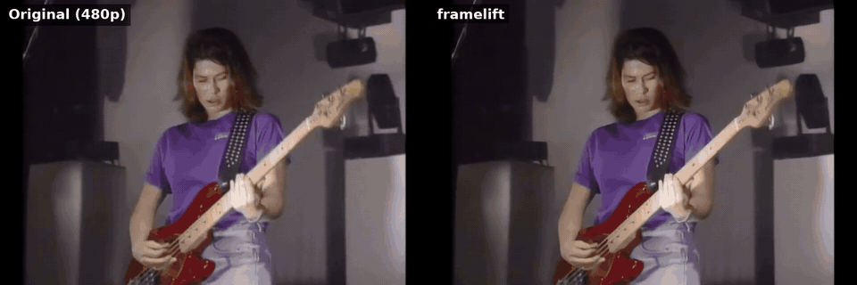
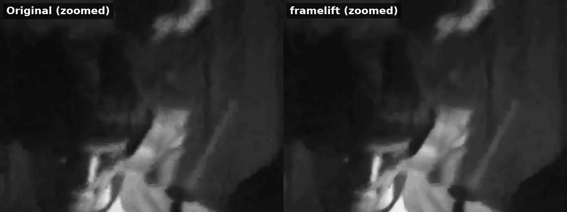
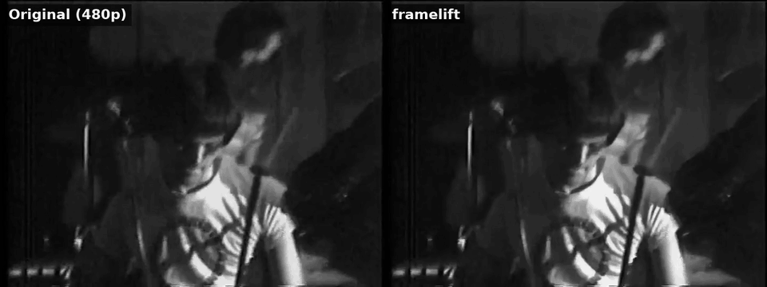
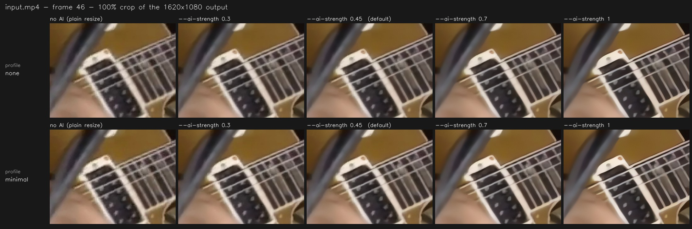

<div align="center">

# 🎞️ framelift

**Aumente a resolução e restaure vídeos com Real-ESRGAN: na GPU NVIDIA, se você tiver uma, ou em qualquer CPU, se não tiver.**

[](https://github.com/pedrodatasci/framelift/actions/workflows/tests.yml)


[English 🇺🇸](README.md) · [🎬 Mais exemplos](GALLERY.pt-BR.md)

</div>

O framelift pega um vídeo antigo, borrado ou de baixa resolução e passa cada frame pelo
[Real-ESRGAN](https://github.com/xinntao/Real-ESRGAN), uma rede neural treinada para
recuperar detalhes. Em vez de entregar o resultado cru da IA (que pode ficar com cara de
plástico), ele **mistura** esse resultado com um redimensionamento clássico de alta
qualidade, para que o vídeo final continue fiel ao original.

```bash
framelift -i vovo_1998.mp4 -o vovo_1998_hd.mp4 --profile old_tv --scale 2
```

## Antes / depois

Dois clipes reais, os dois ampliados de 480p para 1080p. Cada GIF mostra a mesma área lado
a lado: o original à esquerda (só esticado para o mesmo tamanho) e o framelift à direita.

**Clipe musical colorido:** cordas e trastes mais limpos, menos blocos de compressão.



<details>
<summary>Frame inteiro</summary>



</details>

**Gravação de show em preto e branco:** granulação e blocos de compressão limpos, bordas
mais nítidas. Processado na CPU de um notebook.



<details>
<summary>Frame inteiro</summary>



</details>

<sub>Os GIFs são comprimidos e reduzidos para esta página; o MP4 real gerado é mais nítido.</sub>

**[🎬 Mais exemplos na galeria →](GALLERY.pt-BR.md)**

## Destaques

- **Funciona em qualquer máquina.** Usa CUDA quando disponível e cai para a CPU quando
  não, inclusive em notebooks com Intel Iris.
- **Pare quando quiser, sem perder nada.** Aperte <kbd>Ctrl</kbd>+<kbd>C</kbd> uma vez e o
  framelift termina o frame atual e salva um MP4 **reproduzível** com tudo o que já foi
  feito. Depois ele diz exatamente como continuar.
- **Mantém o som.** O áudio original é copiado sincronizado, recortado no trecho
  processado, sem recodificar sempre que possível.
- **Escolha no olho o trecho a melhorar.** O `framelift trim` (ou `--pick-range`) abre um
  player com linha do tempo: arraste o início e o fim, e esse trecho é cortado no frame
  exato, sem perder qualidade, e vira a sua entrada.
- **Resultado natural.** O `--ai-strength` regula a mistura, de "limpeza sutil" até
  "IA total".
- **Perfis de pré-limpeza** para fontes comuns: vídeo de celular, gravações de VHS/TV,
  vídeo com muito ruído.
- **Usa o que a sua máquina tem.** Além de GPUs NVIDIA, roda a IA em GPUs Intel (Iris,
  UHD, Arc) e, pelo OpenVINO da Intel, em qualquer CPU; em CPUs com muitos núcleos, pode
  trabalhar em dois frames ao mesmo tempo. O `framelift tune` mede o que é mais rápido na
  *sua* máquina.
- **Pipeline rápido.** Os frames são decodificados numa thread em segundo plano enquanto
  a IA trabalha, e vão direto para o FFmpeg, sem arquivos de imagem temporários no disco.
- **Movimento mais fluido (RIFE).** Transforme 24/30 fps em 60 fps com frames
  intermediários de verdade, desenhados pelo [RIFE](https://github.com/hzwer/Practical-RIFE)
  (`--interpolate`), ou só repetindo frames. Nos dois casos a duração não muda, e funciona
  junto com a IA ou sozinho (`--no-ai`).
- **Uma biblioteca Python de verdade**, não só um script: `enhance_video(...)`, opções
  tipadas, resultados estruturados e exceções específicas.
- **Os modelos se baixam sozinhos** no primeiro uso.

## Sumário

- [Antes / depois](#antes--depois) (e [mais exemplos](GALLERY.pt-BR.md))
- [Como funciona](#como-funciona)
- [Instalação](#instalação)
- [Primeiros passos](#primeiros-passos)
- [Descobrindo as melhores configurações (`framelift tune`)](#descobrindo-as-melhores-configurações-framelift-tune)
- [Escolhendo o trecho a melhorar (`framelift trim`)](#escolhendo-o-trecho-a-melhorar-framelift-trim)
- [Receitas](#receitas)
- [Referência da linha de comando](#referência-da-linha-de-comando)
- [Modelos](#modelos)
- [Perfis de pré-limpeza](#perfis-de-pré-limpeza)
- [Ajuste de desempenho](#ajuste-de-desempenho)
- [Parar, retomar e juntar partes](#parar-retomar-e-juntar-partes)
- [Áudio](#áudio)
- [API Python](#api-python)
- [Solução de problemas](#solução-de-problemas)
- [Estrutura do projeto](#estrutura-do-projeto)
- [Desenvolvimento](#desenvolvimento)
- [Vindo do antigo `main.py`](#vindo-do-antigo-mainpy)
- [Créditos e licença](#créditos-e-licença)

## Como funciona

```
┌───────────────┐   fila   ┌─────────────┐      ┌─────────────────┐  pipe   ┌────────┐
│ thread leitora│ ───────► │ Real-ESRGAN │ ───► │ mistura com     │ ──────► │ FFmpeg │ ──► saida.mp4
│ decodifica +  │(prefetch)│  (workers)  │      │ resize Lanczos  │  (raw)  │  H.264 │
│ limpa         │          └─────────────┘      └─────────────────┘         └────────┘
└───────────────┘
```

1. **Leitura e pré-limpeza.** Uma thread em segundo plano decodifica os frames e aplica o
   [perfil](#perfis-de-pré-limpeza) escolhido, ficando alguns frames à frente da IA.
2. **Upscale.** O Real-ESRGAN recupera detalhes e amplia o frame até o tamanho final. Ele
   roda na própria thread (ou em várias, com `--workers`), então a IA já está no próximo
   frame enquanto o anterior é misturado e codificado.
3. **Mistura.** O resultado da IA é combinado com um resize Lanczos comum do mesmo frame,
   na proporção definida por `--ai-strength`.
4. **Codificação.** Os frames crus vão por pipe para o FFmpeg (libx264 ou NVENC). O arquivo
   é gravado com um nome temporário e só é renomeado quando o FFmpeg termina sem erros.

Para aumentar o frame rate (`--output-fps`), os frames são repetidos num padrão uniforme.
Com `--interpolate`, o RIFE desenha os frames extras, entre os passos 3 e 4: ele estima
como tudo se move de um frame pronto para o próximo e gera os momentos intermediários. A
IA continua rodando uma vez por frame original. Num corte de cena não há movimento para
seguir, então esses frames são repetidos em vez de misturados.

Um frame idêntico ao anterior (uma imagem parada, um frame duplicado) não passa pela IA de
novo: o resultado seria o mesmo, pixel por pixel, então o anterior é reaproveitado, e o
RIFE não tem nada a desenhar entre os dois.

Antes de embarcar em horas de processamento, o framelift confere se o primeiro frame não
está preto, tanto antes quanto depois da IA. Isso pega cedo problemas de decodificação,
pesos corrompidos e falhas de driver.

Com `--no-ai` (ou `--ai-strength 0`), o passo 2 é pulado e nenhum modelo é carregado:
cada frame recebe só o resize Lanczos. O mesmo pipeline passa então a redimensionar,
pré-limpar ou mudar o frame rate na velocidade de decodificar e codificar o vídeo. A
checagem de frame preto também é pulada, porque ela existe para pegar problemas da IA.

## Instalação

Você precisa de **Python 3.9+** e do **[FFmpeg](https://ffmpeg.org/download.html)** no
`PATH` (o comando `ffmpeg -version` precisa funcionar no terminal).

```bash
git clone https://github.com/pedrodatasci/framelift.git
cd framelift
python -m venv .venv
source .venv/bin/activate          # Windows: .venv\Scripts\activate
```

**Vai usar GPU NVIDIA?** Instale *antes* uma versão do PyTorch com CUDA, usando o comando
que o [pytorch.org](https://pytorch.org/get-started/locally/) indicar para o seu sistema.
Em máquinas só com CPU, pule este passo.

Depois instale o framelift:

```bash
pip install -r requirements.txt    # opcional: as versões exatas já testadas
pip install -e .
framelift --version
```

Isso cria o comando `framelift`. `python -m framelift` também funciona.

**Opcional, para hardware Intel:** `pip install -e ".[intel]"` instala o
[OpenVINO](https://docs.openvino.ai), que permite rodar a IA numa GPU Intel (Iris, UHD,
Arc) com `--device igpu`, ou na CPU com `--backend openvino` (muitas vezes mais rápido que o
PyTorch, em qualquer CPU x86). Com ele instalado, o `framelift tune` testa as duas opções.

**Opcional, para o seletor visual de trecho** ([`framelift trim`](#escolhendo-o-trecho-a-melhorar-framelift-trim)):
instale o [VLC media player](https://www.videolan.org/vlc/) (64 bits se o seu Python for
64 bits) e a biblioteca Python dele:

```bash
pip install -e ".[picker]"         # instala o python-vlc
```

No Linux, o Tkinter também pode precisar de `sudo apt install python3-tk`. Todo o resto
funciona sem eles.

## Primeiros passos

```bash
# 1. Deixe o framelift medir seu vídeo e sua máquina (mostra um comando fast e um best)
framelift tune -i entrada.mp4

# 2. Teste nos primeiros ~10 segundos (300 frames a 30 fps) para avaliar o visual rápido
framelift -i entrada.mp4 -o previa.mp4 --max-frames 300

# 3. Gostou? Rode o vídeo inteiro
framelift -i entrada.mp4 -o saida.mp4
```

Os padrões são um bom ponto de partida: o modelo rápido `realesr-animevideov3`, upscale
de 1,5x e 45% de IA na mistura.

## Descobrindo as melhores configurações (`framelift tune`)

Pequenas mudanças nas configurações podem mudar muito o resultado, e os valores certos
dependem do *seu* vídeo. Deixe o framelift medir:

```bash
framelift tune -i entrada.mp4
```

Leva um ou dois minutos (mais numa CPU lenta com vídeos grandes) e funciona em seis etapas:

1. **Analisa o vídeo.** Em frames espalhados pelo vídeo, mede a **suavidade** (o quanto a
   imagem está borrada), o **ruído** (que define o perfil de limpeza) e a resolução (que
   define uma escala que chegue ao Full HD sem esticar mais de 3x). Para os testes, escolhe
   o frame *estável* mais nítido, evitando movimento rápido e cortes de cena.
2. **Mede a sua máquina.** Processa um frame real com cada configuração candidata e fica com
   a mais rápida que cabe na memória: tamanhos de tile, FP16 na NVIDIA (conferido também sem
   ele, porque em algumas placas antigas o FP16 é mais lento) e, na CPU, **o número de
   threads** (notebooks que misturam núcleos rápidos e de eficiência muitas vezes rendem mais
   com menos threads). Se o [OpenVINO](#instalação) estiver instalado, também cronometra
   **o OpenVINO na CPU** e, se houver, **a GPU Intel** (com e sem FP16), e fica com o mais
   rápido. Também verifica se o NVENC funciona.
3. **Mede o que a IA faz com o seu vídeo.** É aqui que ele se adapta à entrada. Pequenos
   recortes de três frames são ampliados com e sem IA (com um pouco da imagem em volta, para
   a IA não tropeçar em bordas artificiais), e três coisas são medidas:
   - **nitidez:** quanto a IA realmente recupera em comparação com um resize comum;
   - **ruído:** se a IA limpa o ruído ou inventa granulação e textura;
   - **estrutura:** se ela restaura a imagem ou começa a redesenhar detalhes.

   Essas medidas definem a **força da IA**, separadamente para cada modelo. Uma fonte suave
   em que a IA recupera muito recebe uma força alta. Uma fonte que já é nítida, ou um modelo
   que inventa textura nesse vídeo, recebe uma força menor.
4. **Monta dois presets**:
   - **`fast`**: o modelo leve feito para vídeo (`realesr-animevideov3`). Normalmente minutos.
   - **`best`**: um modelo mais pesado (`realesrgan-x4plus`, ou o modelo de anime com
     `--anime`) que recupera mais detalhe, com configurações mais cuidadosas: `--pre-pad 10`
     contra artefatos nas bordas, `--crf 18` para o encoder preservar mais detalhe e um preset
     do x264 mais lento. Numa CPU, pode ser cerca de 45x mais lento.

5. **Cronometra uma execução real curta.** Três frames passam pelo pipeline inteiro com as
   configurações do preset (leitura, limpeza, IA, mistura e codificação, com o encoder
   disputando a CPU como numa execução de verdade), então as estimativas de tempo incluem
   tudo, menos a passada do áudio. Numa CPU com 4 threads ou mais, isso é feito duas vezes
   (5 frames cada): com **um worker de IA** usando todas as threads e com **dois workers**
   dividindo-as, cada um no seu frame. Dois workers só ficam se forem pelo menos 5% mais
   rápidos. Na GPU, os dois presets são cronometrados assim. Na CPU,
   onde um frame do `best` pode levar minutos, é cronometrado um tile do modelo pesado,
   escalado para a divisão exata do frame em tiles. O `best` é recomendado quando a
   estimativa dele fica em até 10 minutos (clipes curtos ou GPU); caso contrário, o
   recomendado é o `fast`.
6. **Gera uma folha de comparação** (`entrada_tune.png`): o mesmo recorte em 100% com cada
   preset (linhas) e diferentes forças de IA (colunas), com a escolha de cada preset marcada.

Esta é a folha real do clipe musical colorido lá de cima. A linha de baixo é o preset
`best`: repare nos rebites da alça, mais definidos. Clique para ver no tamanho original.



E um relatório de uma execução real em outro clipe 720x480, numa máquina de teste com um
único núcleo e o OpenVINO instalado (por isso os tempos são longos e não houve teste de
workers):

```
Your machine
  CPU (no NVIDIA GPU in use, so expect it to be slow)

Your video
  input.mp4  720x480 @ 29.970 fps, 130 frames (0m04s)
  Softness  slightly soft (0.35)
  Noise     very clean (0.4) → profile none
  Size      480p → 1080p → --scale 2.25
  Tested on frame 123 (the sharpest steady one)

What the AI does to it
  animevideov3  sharpness +0.15 · noise ±0.0 · structure 0.98  → AI strength 0.6
                recovers sharpness well
  x4plus        sharpness +0.18 · noise ±0.0 · structure 0.98  → AI strength 0.6
                recovers sharpness well

Speed test (animevideov3, 1620x1080 output)
  tile 256, FP32                       4.52 s/frame
  tile 128, FP32                       5.34 s/frame
  OpenVINO, tile 256, FP32             3.91 s/frame  ← fastest
  Real run, 3 frames with encoding: 4.06 s/frame + 4 s to start
  (real runs include reading, blending, encoding and loading the model)

Presets
  fast  animevideov3 · AI 0.6 · ~9 min measured  (light video model)  ← recommended
  best  x4plus · AI 0.6 · ~4h41 extrapolated  (heavier model, more careful encoding)
  Times include loading the model and encoding (not the audio: a few seconds).
  measured = a short real run of the preset; extrapolated = built from one.

Comparison sheet: /home/you/input_tune.png
  The same 100% crop of frame 123: columns are AI strengths
  (the presets' picks are marked), rows are the presets. Adjust to taste.

Commands
  fast (recommended):
    framelift -i input.mp4 -o input_enhanced.mp4 --scale 2.25 --ai-strength 0.6 --device cpu --backend openvino --x264-preset medium
  best:
    framelift -i input.mp4 -o input_enhanced_best.mp4 --model realesrgan-x4plus --scale 2.25 --ai-strength 0.6 --device cpu --backend openvino --pre-pad 10 --crf 18 --x264-preset slow
```

Vale saber:

- **Rápido contra melhor é questão de modelo, não de força da IA.** A força da IA é só uma
  mistura no final e não custa tempo nenhum. Os presets diferem no modelo e no capricho da
  codificação; cada um recebe a força que funciona melhor com o seu vídeo.
- **Tudo o que você passar é mantido.** `framelift tune -i vhs.mp4 --scale 2 --profile old_tv`
  mantém sua escala e seu perfil, ajusta o resto e marca os seus com "(yours)". Com
  `--model`, só aquele modelo é ajustado (sem a escolha entre fast e best).
- **As medições são um ótimo ponto de partida; quem decide é a folha.** As regras da força
  foram calibradas num punhado de clipes (vídeos sintéticos nítidos, borrados e granulados,
  além de filmagens antigas reais), e o gosto continua importando. Escolha o recorte da folha
  de que mais gostar e ajuste `--ai-strength` de acordo.
- **Granulação e manchas não são a mesma coisa.** Filmagens antigas costumam ter manchas nas
  áreas escuras, deixadas por compressões anteriores. Elas não são ruído de pixel, então a
  medição de ruído não as conta e não sugere perfil de limpeza; a etapa 3 mede como a IA lida
  com elas. Se elas incomodarem, rode o tune de novo com `--profile soft_camera` e compare
  as folhas.
- **As estimativas de tempo vêm de uma execução real curta**, então incluem o carregamento
  do modelo e a codificação. Nos nossos testes, a execução real de 40 frames levou 7% a mais
  que o estimado (205 s contra 191 s, já contando a inicialização do próprio Python). Na CPU,
  a estimativa do `best` é montada a partir de um tile cronometrado do modelo pesado, e não
  de um frame inteiro; use-a como uma boa referência.
- **A primeira execução baixa o modelo mais pesado** (67 MB). O `--no-best` pula essa etapa e
  ajusta só o preset `fast`.
- **Em CPUs lentas com vídeos Full HD ou maiores, o próprio teste de velocidade pode levar
  vários minutos.** O `--no-benchmark` pula essa etapa (e a execução real curta) e ainda
  entrega as medições, os presets (sem estimativa de tempo) e a folha.
- **Os dois presets gravam em arquivos diferentes** (`_enhanced.mp4` e `_enhanced_best.mp4`),
  então dá para rodar os dois num clipe curto e comparar.

| Flag | Padrão | Descrição |
| --- | --- | --- |
| `-i`, `--input VIDEO` | *obrigatório* | Vídeo a analisar. |
| `-o`, `--output MP4` | `<entrada>_enhanced.mp4` | Usado só para montar os comandos sugeridos (o `best` acrescenta `_best`). |
| `--samples N` | `6` | Frames espalhados pelo vídeo que são analisados em ruído, suavidade e movimento. |
| `--sheet PNG` | `<entrada>_tune.png` | Onde salvar a folha de comparação (por padrão, na pasta atual). |
| `--no-sheet` | desligado | Não gera a folha de comparação. |
| `--no-benchmark` | desligado | Pula o teste de velocidade e a execução real curta: bem mais rápido na CPU, mas sem ajuste de tile/FP16/threads e sem estimativas de tempo. |
| `--no-best` | desligado | Ajusta só o preset `fast`: pula o modelo mais pesado e o download dele. |
| `--anime` | desligado | O vídeo é animação: o preset `best` usa o `realesrgan-x4plus-anime-6B`. |
| `--model`, `--device`, `--gpu-id`, `--weights-dir`, `--torch-threads`, `--workers`, `--backend`, `--profile`, `--scale`, `--same-resolution`, `--ai-strength`, `--tile`, `--half`, `--encoder`, `--start-frame`, `--max-frames` | não definidas | Mesmo significado do comando principal. O que você passar é mantido e levado para os comandos sugeridos. `--start-frame` e `--max-frames` mudam as estimativas de tempo. |
| `-v`, `-q` | | Mais detalhes / só o relatório final. |

Os códigos de saída são os mesmos do comando principal; <kbd>Ctrl</kbd>+<kbd>C</kbd> cancela com código 130.

## Escolhendo o trecho a melhorar (`framelift trim`)

Muitas vezes só uma parte do vídeo importa: uma música do show, uma cena da fita. Escolha
no olho:

```bash
framelift trim -i show.mp4
```

Abre uma janela de player (quem reproduz é o VLC, então fica fluido mesmo com arquivos
grandes) com uma linha do tempo embaixo do vídeo:

- **arraste as duas alças brancas** para marcar o início e o fim; o vídeo acompanha, então
  você vê o frame exato em que está. Clique em qualquer outro ponto da linha do tempo para
  mover a agulha;
- ou use as teclas: <kbd>Espaço</kbd> play/pause, <kbd>I</kbd> / <kbd>O</kbd> marcam o início /
  fim na agulha, <kbd>←</kbd> <kbd>→</kbd> um frame, <kbd>Shift</kbd>+<kbd>←</kbd>
  <kbd>→</kbd> um segundo, <kbd>Home</kbd> / <kbd>End</kbd> vão para o início / fim,
  <kbd>M</kbd> tira o som;
- **Play selection** toca só o trecho escolhido e para no último frame dele;
- <kbd>Enter</kbd> (ou **Use this range**) confirma, <kbd>Esc</kbd> cancela.

O trecho escolhido é salvo como um **arquivo novo**, `show_trim_<primeiro>-<último frame>.mp4`
ao lado do original, e o framelift mostra os comandos para ajustar e melhorar esse arquivo.
O original nunca é alterado. A cópia cortada:

- **começa e termina exatamente nos frames escolhidos**, mesmo entre keyframes;
- **tem exatamente os mesmos pixels** do original: o vídeo é guardado sem perdas. O preço é
  o tamanho, algo como 10–30x o original, então apague-a quando terminar;
- **mantém o áudio sincronizado até a amostra**, também sem perdas (ALAC). Ele é convertido
  para AAC quando o vídeo melhorado é salvo.

A partir daí **o corte é a sua entrada**: `--start-frame` e `--max-frames` contam dentro
dele, então parar no meio e [retomar](#parar-retomar-e-juntar-partes) funciona como sempre.

Para escolher e melhorar de uma vez, acrescente `--pick-range` ao comando normal:

```bash
framelift -i show.mp4 -o musica3_hd.mp4 --pick-range
```

Se a execução parar antes do fim, a dica de retomada aponta para o corte (`-i
show_trim_….mp4 --start-frame N`); rode esse comando sem `--pick-range`. Escolher de novo
o mesmo trecho reaproveita o corte já feito, em vez de cortar duas vezes.

Sem área de trabalho (servidor, SSH)? Informe os tempos, e nenhuma janela é aberta:

```bash
framelift trim -i show.mp4 --start 1:30 --end 2:45.5
```

| Flag | Padrão | Descrição |
| --- | --- | --- |
| `-i`, `--input VIDEO` | *obrigatório* | Vídeo a cortar. |
| `-o`, `--output MP4` | `<entrada>_trim_<primeiro>-<último>.mp4` | Onde salvar o corte (por padrão, ao lado da entrada). |
| `--start TEMPO` | o começo | Início, sem a janela: segundos (`90.5`), `M:SS` (`1:30`) ou `H:MM:SS` (`1:02:03`). |
| `--end TEMPO` | o fim | Fim, nos mesmos formatos. Informe um dos dois, ou os dois, para não abrir a janela. |
| `-v`, `-q` | | Mais detalhes / só avisos e erros. |

Códigos de saída: `0` salvo, `1` erro ou janela fechada sem escolher, `130`
<kbd>Ctrl</kbd>+<kbd>C</kbd>. O seletor precisa do VLC e do python-vlc (veja
[Instalação](#instalação)); `--start`/`--end`, não.

## Receitas

| Objetivo | Comando |
| --- | --- |
| Prévia rápida | `framelift -i in.mp4 -o prev.mp4 --max-frames 300` |
| Fita VHS / gravação de TV | `framelift -i vhs.mp4 -o out.mp4 --profile old_tv --scale 2 --ai-strength 0.5` |
| Vídeo de celular, limpeza sutil | `framelift -i cel.mp4 -o out.mp4 --profile soft_camera --ai-strength 0.3` |
| Vídeo com muito ruído | `framelift -i ruido.mp4 -o out.mp4 --profile heavy_noise` |
| Anime / desenho | `framelift -i ep01.mp4 -o out.mp4 --model realesrgan-x4plus-anime-6B --scale 2 --ai-strength 0.8` |
| Máximo de detalhe (lento) | `framelift -i in.mp4 -o out.mp4 --model realesrgan-x4plus --ai-strength 0.6` |
| Restaurar sem redimensionar | `framelift -i in.mp4 -o out.mp4 --same-resolution` |
| Converter para 60 fps | `framelift -i in.mp4 -o out.mp4 --output-fps 60` |
| Só mudar o frame rate (sem IA, rápido) | `framelift -i in.mp4 -o out.mp4 --no-ai --same-resolution --output-fps 60` |
| Movimento mais fluido: 60 fps com RIFE | `framelift -i in.mp4 -o out.mp4 --output-fps 60 --interpolate` |
| Só deixar mais fluido (sem IA) | `framelift -i in.mp4 -o out.mp4 --no-ai --same-resolution --interpolate` |
| GPU NVIDIA a toda velocidade | `framelift -i in.mp4 -o out.mp4 --device cuda --half --tile 768 --encoder nvenc` |
| Notebook Intel (CPU) | `framelift -i in.mp4 -o out.mp4 --device cpu --tile 128 --torch-threads 8` |
| Retomar depois do frame 1200 | `framelift -i in.mp4 -o parte2.mp4 --start-frame 1201` |
| Só um trecho do vídeo | `framelift -i in.mp4 -o trecho.mp4 --pick-range` |

## Referência da linha de comando

```
framelift -i ENTRADA -o SAIDA [opções]
```

`framelift --help` mostra as mesmas informações no terminal.

### Entrada / saída

| Flag | Padrão | Descrição |
| --- | --- | --- |
| `-i`, `--input VIDEO` | *obrigatório* | Vídeo a melhorar. Qualquer formato que OpenCV/FFmpeg leiam (MP4, MKV, AVI, MOV…). |
| `-o`, `--output MP4` | *obrigatório* | Onde salvar o resultado. Pastas inexistentes são criadas. Um arquivo que já exista nesse caminho **só** é substituído quando o novo termina com sucesso. |
| `--no-audio` | áudio ligado | Deixa o áudio de fora. Por padrão, o áudio da entrada é copiado, recortado no trecho processado. Veja [Áudio](#áudio). |

### Aparência do resultado

| Flag | Padrão | Descrição |
| --- | --- | --- |
| `--model NOME` | `realesr-animevideov3` | Modelo do Real-ESRGAN. Veja [Modelos](#modelos) ou `framelift --list-models`. |
| `--scale FATOR` | `1.5` | Tamanho da saída em relação à entrada: `2` dobra largura e altura, `1.25` aumenta 25%. Valores abaixo de 1 reduzem o vídeo (que ainda passa pela IA). Ignorado com `--same-resolution`. |
| `--same-resolution` | desligado | Mantém exatamente a resolução de entrada. Útil para melhorar a qualidade sem aumentar o arquivo. |
| `--ai-strength N` | `0.45` | Participação da IA na imagem final, de `0` a `1`. `1.0` = IA pura (mais nítido, pode parecer artificial); `0.45` = equilibrado; `0.30` = natural; `0` = só resize Lanczos, sem nem rodar a IA (como o `--no-ai`). Valores fora de 0–1 são limitados. |
| `--no-ai` | IA ligada | Pula a IA por completo: nenhum modelo é carregado, e o `--device` e as outras opções da IA não importam. Sobram a pré-limpeza (`--profile`), um resize Lanczos comum (`--scale`) e a mudança de frame rate (`--output-fps`), na velocidade de decodificar e codificar o vídeo. `--no-ai --same-resolution --output-fps 60` só muda o frame rate. |
| `--profile NOME` | `none` | Filtro de limpeza aplicado *antes* da IA. Veja [Perfis](#perfis-de-pré-limpeza) ou `framelift --list-profiles`. |
| `--output-fps FPS` | igual à entrada | Frame rate da saída. Valores maiores repetem frames num padrão uniforme, então **a duração não muda** (ex.: de 24 para 60 fps, cada frame é escrito 2 ou 3 vezes). Não pode ser menor que o da entrada. Sozinho, não cria movimento novo, mas ajuda quando uma plataforma ou editor exige 60 fps; acrescente `--interpolate` para frames intermediários de verdade. |
| `--interpolate` | desligado | Desenha os frames extras com o [RIFE](https://github.com/hzwer/Practical-RIFE) em vez de repeti-los: frames intermediários novos, então o movimento fica mais fluido de verdade. Sem `--output-fps`, dobra o frame rate. Funciona com a IA (ele roda nos frames prontos, então a IA continua rodando uma vez por frame original) ou com `--no-ai`. Usa o mesmo dispositivo da IA (`--device`, `--half`, `--backend`); os pesos (25 MB) são baixados no primeiro uso. Cortes de cena são repetidos, não misturados. Movimentos muito rápidos e coisas se cruzando (mãos, cabelo) podem ter pequenos artefatos. Escolha um múltiplo exato do fps da entrada (ou deixe o `--output-fps` de fora): a 60 fps a partir de 29,99, os momentos intermediários se deslocam e o RIFE desenha até ~75% mais frames. O framelift avisa quando isso acontece e diz o fps exato a usar. |

### Quais frames processar

| Flag | Padrão | Descrição |
| --- | --- | --- |
| `--start-frame N` | `1` | Primeiro frame a processar, contando a partir de **1**. Serve para retomar uma execução interrompida: se o último frame feito foi o 1200, passe `1201`. |
| `--max-frames N` | todos | Processa no máximo `N` frames a partir de `--start-frame`. Ideal para prévias e para dividir trabalhos longos em sessões. |
| `--pick-range` | desligado | Antes de processar, abre o [seletor de trecho](#escolhendo-o-trecho-a-melhorar-framelift-trim) para escolher a parte a melhorar. Essa parte é salva como `<entrada>_trim_<primeiro>-<último>.mp4` e vira a entrada; `--start-frame` e `--max-frames` passam a contar dentro dela. Precisa do VLC. |

### Hardware e desempenho

| Flag | Padrão | Descrição |
| --- | --- | --- |
| `--device {auto,cpu,cuda,igpu}` | `auto` | Onde a IA roda. `auto` usa a GPU NVIDIA se o PyTorch enxergar uma, senão a CPU. `igpu` roda numa GPU Intel (Iris, UHD, Arc) pelo OpenVINO (`pip install openvino`); o `auto` nunca a escolhe sozinho, quem verifica se ela é mais rápida é o `framelift tune`. `cuda` e `igpu` falham com mensagem clara se aquela GPU não puder ser usada. |
| `--gpu-id ID` | `0` | Qual GPU CUDA usar em máquinas com várias (o `nvidia-smi` lista os IDs). |
| `--half` | desligado | Roda o modelo em FP16 na GPU (CUDA ou `igpu`): mais rápido e com cerca de metade da memória, sem perda visível. Ignorado (com aviso) na CPU. |
| `--tile PX` | `256` | Divide cada frame em blocos quadrados desse tamanho antes da IA, o que limita o uso de memória. **Diminua** se faltar memória; **aumente** numa GPU grande para ganhar velocidade. `0` processa o frame inteiro de uma vez. Veja [Ajuste de desempenho](#ajuste-de-desempenho). |
| `--tile-pad PX` | `10` | Sobreposição entre blocos vizinhos, que esconde emendas. Raramente precisa mudar. |
| `--pre-pad PX` | `0` | Margem adicionada em volta do frame inteiro antes da inferência. Um valor pequeno (ex.: `10`) pode reduzir artefatos nas bordas da imagem. |
| `--torch-threads N` | `0` | Threads de CPU para a IA, **por worker** (o OpenVINO na CPU também usa). `0` deixa o PyTorch decidir (geralmente todos os núcleos), dividindo igualmente entre os workers. Usar o número de núcleos *físicos* pode ajudar em alguns notebooks. |
| `--workers N` | `1` | Quantos frames a IA processa ao mesmo tempo, cada um com sua parte das threads de CPU. `2` pode ser mais rápido em CPUs com muitos núcleos (o `framelift tune` mede). Usa um pouco mais de memória; a saída é a mesma. |
| `--backend {torch,openvino}` | `torch` | O que roda a IA na CPU. O `openvino` (runtime da Intel, `pip install openvino`) foi ~13% mais rápido nos nossos testes com o modelo padrão e ~20% com o `x4plus`, arredondando alguns valores de outro jeito (no máximo 1 nível em 255). O `framelift tune` compara os dois na sua máquina. |
| `--prefetch N` | `2` | Quantos frames já limpos a thread leitora deixa prontos. Aumente (ex.: `4`–`8`) com perfis lentos como `heavy_noise` numa GPU rápida. Cada frame custa um pouco de RAM. |
| `--weights-dir PASTA` | `weights` | Pasta onde ficam os arquivos dos modelos. Os que faltarem são baixados aqui automaticamente no primeiro uso (relativa à pasta atual). |

### Codificação

| Flag | Padrão | Descrição |
| --- | --- | --- |
| `--encoder {cpu,nvenc}` | `cpu` | `cpu` usa libx264 e funciona em qualquer lugar. `nvenc` usa o codificador de hardware da NVIDIA (mais rápido, libera a CPU). Se o NVENC não puder ser usado (sem GPU NVIDIA, rodando com `--device cpu` ou FFmpeg compilado sem ele), o framelift explica o motivo e volta para `cpu`. |
| `--crf N` | `20` | Alvo de qualidade. **Menor = mais qualidade e arquivos maiores.** 18 é visualmente sem perdas para a maioria dos vídeos, 18–22 é a faixa ideal, e acima de 26 os artefatos começam a aparecer. Com `nvenc`, o valor vai como `-cq`. |
| `--x264-preset NOME` | `veryfast` | Equilíbrio velocidade/tamanho do libx264: `ultrafast`, `superfast`, `veryfast`, `faster`, `fast`, `medium`, `slow`. Presets mais lentos geram arquivos menores com a mesma qualidade. Como a IA costuma ser o gargalo, `medium` muitas vezes quase não adiciona tempo. Só vale para o encoder `cpu`. |

### Diagnóstico

| Flag | Padrão | Descrição |
| --- | --- | --- |
| `--debug-timings` | desligado | Mostra de tempos em tempos quanto cada etapa leva (espera pelo leitor, espera pela IA, mistura, escrita). Na CUDA, sincroniza a GPU para os números serem reais, o que custa um pouco de velocidade. |
| `--timing-every N` | `20` | Com `--debug-timings`: relatório a cada `N` frames. |
| `--gc-every N` | `0` | Com `--debug-timings`: roda o coletor de lixo do Python e libera a memória de GPU em cache a cada `N` frames. `0` = nunca. Ferramenta de diagnóstico para suspeita de vazamento de memória. |
| `-v`, `--verbose` | desligado | Mostra mais detalhes: comandos do FFmpeg, caminhos de arquivos, valores das verificações e o traceback completo em erros inesperados. |
| `-q`, `--quiet` | desligado | Mostra só avisos e erros (a barra de progresso continua). |

### Informações

| Flag | Descrição |
| --- | --- |
| `--list-models` | Descreve os modelos disponíveis e sai. |
| `--list-profiles` | Descreve os perfis de pré-limpeza e sai. |
| `--version` | Mostra a versão e sai. |
| `-h`, `--help` | Mostra todas as opções com exemplos. |

### Legadas (aceitas, mas ignoradas)

| Flag | Por que ainda existe |
| --- | --- |
| `--frame-format` | Versões antigas salvavam os frames como imagens. Agora eles vão direto para o FFmpeg, então essa flag não faz nada; ela é aceita para que comandos antigos continuem rodando. |
| `--keep-temp` | Mesmo caso: não existem mais arquivos temporários de frames para manter. |

### Códigos de saída

| Código | Significado |
| --- | --- |
| `0` | Sucesso, inclusive quando um vídeo parcial é salvo após um único <kbd>Ctrl</kbd>+<kbd>C</kbd>. |
| `1` | Erro (arquivo inexistente, opção inválida, falha do FFmpeg, falta de memória…). A mensagem diz o que fazer. |
| `2` | Uso inválido da linha de comando (flag desconhecida, valor fora das opções). |
| `130` | Interrompido na hora com um segundo <kbd>Ctrl</kbd>+<kbd>C</kbd>. |

## Modelos

| Nome | Melhor para | Velocidade | Observações |
| --- | --- | --- | --- |
| `realesr-animevideov3` *(padrão)* | Vídeo em geral, animação | ⚡⚡⚡ | Rede pequena feita para vídeo, e de longe a mais rápida. Comece por ela. |
| `realesrgan-x4plus` | Filmagens reais | 🐢 | Mais detalhe, mas lento: cerca de 45x mais lento que o padrão numa CPU nos nossos testes. Pode inventar texturas; combine com um `--ai-strength` menor. |
| `realesrnet-x4plus` | Filmagens reais, visual mais suave | 🐢 | Mesmo tamanho do x4plus, inventa menos texturas. |
| `realesrgan-x4plus-anime-6B` | Anime, desenhos, ilustrações | ⚡⚡ | Preserva cores chapadas e traços limpos. |

Todos os modelos são treinados para 4x. O framelift depois redimensiona para o seu
`--scale`, então você não é obrigado a gerar vídeo 4x maior. Os pesos (cerca de 2,5 MB
no modelo padrão, 18 MB no modelo de anime e 67 MB nos outros dois) são baixados automaticamente das releases
oficiais do Real-ESRGAN na primeira vez que o modelo é usado.

## Perfis de pré-limpeza

A IA realça *tudo*, inclusive ruído e blocos de compressão. Uma limpeza leve antes
costuma deixar o resultado mais natural.

| Perfil | O que faz | Use para | Custo |
| --- | --- | --- | --- |
| `none` *(padrão)* | Nada. | Fontes limpas. | zero |
| `minimal` | +2% de contraste e saturação, nitidez leve. | Vídeo um pouco apagado. | ~zero |
| `soft_camera` | Suavização leve que preserva bordas (bilateral), realce suave de cor, nitidez. | Celular e webcam com granulação fina. | baixo |
| `old_tv` | Suavização bilateral mais forte, mais contraste e cor. | VHS, DVD, gravações de TV. | baixo |
| `heavy_noise` | Remoção de ruído por non-local means, depois tom e nitidez. | Vídeo muito granulado, com pouca luz ou muito comprimido. | **alto** (CPU) |

O `heavy_noise` roda na CPU, dentro da thread leitora. Numa GPU rápida ele pode virar o
gargalo; aumentar o `--prefetch` ajuda um pouco.

## Ajuste de desempenho

A etapa da IA domina o tempo total. O jeito mais rápido de ajustá-la é o
[`framelift tune`](#descobrindo-as-melhores-configurações-framelift-tune), que mede tudo
na sua máquina. Fora isso, um guia aproximado:

| Hardware | Configuração sugerida |
| --- | --- |
| NVIDIA com 8 GB+ de VRAM | `--device cuda --half --tile 768` (ou `--tile 0` se couber) `--encoder nvenc` |
| NVIDIA com 4–6 GB de VRAM | `--device cuda --half --tile 384` |
| Intel Iris / UHD / Arc | instale o OpenVINO e rode o `framelift tune`: ele compara o `--device igpu` com a CPU |
| CPU (Intel / AMD) | `--device cpu --tile 128` ou `256`, modelo padrão; teste `--backend openvino` e, com muitos núcleos, `--workers 2` (o `framelift tune` testa os dois) |
| Apple | `--device cpu --tile 128` ou `256`, modelo padrão, e veja a dica de threads abaixo |

- **Faltou memória?** Corte o `--tile` pela metade. É o principal controle de memória.
- **Para onde vai o tempo?** Use `--debug-timings`. Muito tempo em `queue` indica que a
  leitura (o perfil) é o gargalo; em `ai` (o tempo esperando a IA), o modelo; em `write`, o
  encoder (tente `--encoder nvenc` ou um `--x264-preset` mais rápido).
- **O modelo pesa mais que qualquer outra opção:** o `realesr-animevideov3` foi cerca de 45x
  mais rápido que o `realesrgan-x4plus` numa CPU nos nossos testes.
- **O modelo padrão ficou ~30% mais rápido na CPU na 1.4.** Ele agora roda no formato de
  memória preferido pela biblioteca de cálculo da CPU (channels-last); nos nossos testes, um
  frame 720x480 passou de 8,3 para 5,8 s. Os modelos mais pesados ficaram *mais lentos*
  assim, então continuam como antes.
- **O `--scale` quase não muda a velocidade.** Os modelos sempre ampliam 4x internamente e
  só redimensionam para a sua escala no fim, então gerar 1080p custa praticamente o mesmo
  tempo de IA que 720p.
- **A IA e o resto se sobrepõem.** A IA roda na própria thread: enquanto ela
  trabalha no próximo frame, o anterior é redimensionado, misturado e codificado. Isso só
  ajuda quando sobram núcleos; num único núcleo dá empate (os mesmos 55–56 s para 12 frames
  nos nossos testes). A saída é idêntica bit a bit à de antes.
- **Dois workers em CPUs com muitos núcleos.** O PyTorch espalha um frame por todos os
  núcleos, mas fica menos eficiente conforme eles aumentam, principalmente em notebooks que
  misturam núcleos rápidos e de eficiência. O `--workers 2` dá a cada um de dois frames
  metade das threads. Se isso é mais rápido depende da CPU, então o `framelift tune` mede
  com duas execuções reais curtas.
- **OpenVINO.** O runtime da Intel costuma ser mais rápido que o PyTorch na CPU
  (`--backend openvino`) e consegue usar GPUs Intel (`--device igpu`). A primeira execução
  compila o modelo para cada tamanho de tile (alguns segundos na CPU, mais numa GPU); o
  resultado fica em `weights/openvino_cache/`, então as próximas começam mais rápido.
- **Mais threads de CPU nem sempre é mais rápido.** Em notebooks que misturam núcleos de
  desempenho e de eficiência, um `--torch-threads` menor (algo como 4–6) pode ganhar de usar
  todos. O `framelift tune` testa isso para você. E deixe o notebook na tomada e fora do
  modo de economia de energia.
- Na CPU, espere algo na casa de segundos por frame, e não de frames por segundo. Teste
  antes com `--max-frames` para estimar o tempo total.

## Parar, retomar e juntar partes

Aperte <kbd>Ctrl</kbd>+<kbd>C</kbd> **uma vez**: o framelift termina o frame em andamento,
fecha o MP4 direitinho e mostra algo como:

```
Saved a partial video /videos/out.mp4
  frames 1 → 1200 (1200 enhanced, 1200 written) in 42m10s
To continue from here, run again with:  --start-frame 1201
```

Aperte **duas vezes** para sair na hora (código 130). O FFmpeg ainda consegue fechar o
arquivo dele, que fica como `out.encoding_tmp.mp4`.

Para continuar, rode o mesmo comando com um **novo nome de saída** e o frame sugerido:

```bash
framelift -i in.mp4 -o parte2.mp4 --start-frame 1201
```

Depois junte as partes sem perda de qualidade com o FFmpeg (cada parte leva o próprio
trecho de áudio, então o arquivo final continua sincronizado):

```bash
printf "file 'out.mp4'\nfile 'parte2.mp4'\n" > partes.txt
ffmpeg -f concat -safe 0 -i partes.txt -c copy completo.mp4
```

> [!TIP]
> `--start-frame` junto com `--max-frames` permite dividir de propósito um trabalho longo
> em sessões, por exemplo 5000 frames por noite.

## Áudio

O framelift copia o áudio da entrada para a saída automaticamente, sincronizado:

- **Só o trecho correspondente.** Com `--start-frame`, `--max-frames`, ou depois de um
  <kbd>Ctrl</kbd>+<kbd>C</kbd>, o áudio cobre exatamente os frames processados. Partes
  feitas assim podem ser [juntadas](#parar-retomar-e-juntar-partes) e continuam sincronizadas.
- **Sem perda de qualidade quando possível.** AAC, MP3, AC-3 e E-AC-3 são copiados como
  estão. Outros codecs (como o áudio PCM comum em capturas AVI ou MOV) são convertidos para
  AAC a 192 kbps, porque muitos players não conseguem tocá-los dentro de um MP4.
- **O vídeo nunca corre risco.** O áudio entra numa segunda passada rápida, depois que o
  vídeo está pronto. Se a entrada não tiver áudio, a saída sai sem som; se algo falhar ao
  adicioná-lo, o vídeo é salvo mesmo assim, sem som e com um aviso.

Use `--no-audio` para deixar o áudio de fora (`audio=False` em Python). Em Python,
`result.audio` diz o que aconteceu: `"copied"` (copiado), `"converted"` (convertido),
`"none"` (a entrada não tem áudio), `"failed"` (falhou) ou `"disabled"` (desligado). Nos
nossos testes, o áudio ficou alinhado com
o vídeo com diferença abaixo de um milissegundo, inclusive depois de juntar partes e de
converter 30 → 60 fps.

## API Python

Tudo o que a CLI faz está disponível em Python, com os mesmos nomes de opção
(`--ai-strength` → `ai_strength`).

### Em uma chamada

```python
from framelift import enhance_video

result = enhance_video("in.mp4", "out.mp4", scale=2, profile="old_tv", ai_strength=0.5)

print(f"{result.frames_written} frames escritos em {result.elapsed_seconds:.0f}s")
if result.resume_from:
    print("Continue depois com start_frame =", result.resume_from)
```

Sem a IA (`--no-ai`), por exemplo para só mudar o frame rate:

```python
enhance_video("in.mp4", "in_60fps.mp4", ai=False, same_resolution=True, output_fps=60)
```

Com os frames intermediários do RIFE (`--interpolate`):

```python
result = enhance_video("in.mp4", "suave.mp4", output_fps=60, interpolate=True)
print(result.frames_interpolated, "frames novos desenhados pelo RIFE")
```

### Configuração reutilizável e processamento em lote

O `VideoEnhancer` carrega o modelo uma vez só e o reaproveita em todos os vídeos:

```python
from pathlib import Path
from framelift import EnhanceOptions, VideoEnhancer

enhancer = VideoEnhancer(EnhanceOptions(scale=2, profile="soft_camera", device="cuda", half=True))

for clip in Path("brutos").glob("*.mp4"):
    enhancer.enhance(clip, Path("melhorados") / clip.name)
```

### Parando pelo código

Passe um `threading.Event`; acioná-lo tem o mesmo efeito de um Ctrl+C:

```python
import threading
from framelift import enhance_video

stop = threading.Event()
threading.Timer(600, stop.set).start()  # desiste após 10 minutos, guardando o que foi feito

result = enhance_video("longo.mp4", "out.mp4", stop_event=stop)
print("interrompido:", result.interrupted)
```

### Mensagens e progresso

O framelift usa o módulo padrão `logging`, no logger `"framelift"`, e não imprime nada
por conta própria além da barra de progresso. Para ver a mesma saída amigável da CLI:

```python
import framelift

framelift.setup_console(verbosity=0)  # -1 = só avisos, 1 = debug
```

Passe `show_progress=False` para esconder a barra de progresso.

### Tratando erros

Todos os erros herdam de `framelift.FrameliftError`:

| Exceção | Quando |
| --- | --- |
| `InvalidOptionError` | Uma opção não tem como funcionar (também é `ValueError`). |
| `VideoReadError` | A entrada não existe, não pode ser lida ou não tem frame rate. |
| `MissingDependencyError` | FFmpeg ou os pacotes do Real-ESRGAN não estão instalados. |
| `OutOfMemoryError` | O modelo ficou sem memória; tente de novo com `tile` menor. |
| `EncodingError` | O FFmpeg falhou. |
| `BlackFrameError` | O primeiro frame está preto antes ou depois da IA. |
| `NothingToDoError` | Nenhum frame foi processado. |

```python
from framelift import EnhanceOptions, OutOfMemoryError, VideoEnhancer

options = EnhanceOptions(device="cuda", tile=1024)
while True:
    try:
        VideoEnhancer(options).enhance("in.mp4", "out.mp4")
        break
    except OutOfMemoryError:
        if options.tile <= 64:
            raise  # nem blocos pequenos cabem: desiste
        options.tile //= 2
        print("Sem memória, tentando de novo com tile", options.tile)
```

### Descobrindo configurações pelo código

```python
from framelift import enhance_video, tune_video

report = tune_video("clip.mp4", sheet_path="clip_tune.png")
print(report.softness_label, "→ recomendado:", report.recommended_preset)

for name, preset in report.presets.items():
    print(name, preset.options.model, preset.options.ai_strength, preset.estimated_seconds)

enhance_video("clip.mp4", "clip_hd.mp4", report.presets["fast"].options)
```

`report.recommended` traz as opções do preset recomendado, e `report.model_tests` guarda o
que cada modelo faz, medido, com o vídeo. Passe `options=EnhanceOptions(...)` como ponto de
partida e `keep={"profile", "scale"}` para fixar as configurações que você já decidiu.
`try_best=False` pula o modelo mais pesado, `content="anime"` escolhe o modelo de anime para o
preset `best`, e `benchmark=False` pula o teste de velocidade. `report.real_run` guarda a
execução real curta (`report.real_runs` traz as duas quando 1 e 2 workers foram comparados),
o `basis` de cada preset diz se o tempo foi `"measured"` (medido) ou `"extrapolated"`
(extrapolado), e cada item de `report.runs` diz qual `device` e qual `backend` mediu.

### Escolhendo o trecho pelo código

```python
from framelift import FrameRange, enhance_video, pick_range, trim_video

frames = pick_range("show.mp4")  # abre a janela do player; None se cancelar
# frames = FrameRange(2701, 4500)  # ou decida você (frames contam a partir de 1, ambos incluídos)
if frames:
    cut = trim_video("show.mp4", "musica3.mp4", frames)
    enhance_video(cut.path, "musica3_hd.mp4")
```

O `trim_video` funciona sem o VLC; só o `pick_range` precisa dele.

### Peças avulsas

As partes também funcionam sozinhas:

```python
import cv2
from framelift import (
    EnhanceOptions,
    apply_profile,
    estimate_noise,
    plan_run,
    probe_video,
    softness,
    suggest_size,
)

info = probe_video("in.mp4")  # fps, frame_count, width, height
plan = plan_run(info, EnhanceOptions(scale=2))  # tamanhos e intervalos, sem processar nada
limpo = apply_profile(cv2.imread("frame.png"), "old_tv")
ruido = estimate_noise(limpo)  # ~0 = limpo, 10+ = muito ruidoso
borrado = softness(limpo)  # ~0,15 = nítido, 0,5+ = suave
suggest_size(640, 360).scale  # 3.0 (360p → 1080p)
```

Mais exemplos em [`examples/`](examples/).

## Solução de problemas

**A saída saiu sem som**: confira as mensagens no fim da execução. Se a entrada não tiver
trilha de áudio, o framelift avisa. Se algo falhou ao adicionar o áudio, ele mostra um
aviso; rode de novo com `-v` para ver o erro do FFmpeg. O framelift também precisa do
`ffprobe`, que vem junto com o FFmpeg, para ler o áudio.

**`Couldn't find 'ffmpeg' on your PATH`**: instale o FFmpeg e abra um terminal novo. No
Windows, adicione ao `PATH` a pasta que contém o `ffmpeg.exe`.

**`You asked for --device cuda, but PyTorch can't see a CUDA GPU`**: ou não há GPU NVIDIA
(use `--device cpu`), ou o PyTorch instalado é a versão só para CPU. Confira com
`python -c "import torch; print(torch.cuda.is_available())"` e reinstale o PyTorch pelo
[pytorch.org](https://pytorch.org/get-started/locally/).

**`Ran out of memory while upscaling`**: diminua o `--tile` (256 → 128 → 64). Na CUDA, o
`--half` corta o uso de memória mais ou menos pela metade.

**`No module named 'torchvision.transforms.functional_tensor'`**: é uma incompatibilidade
conhecida entre o `basicsr` e o torchvision 0.17+. O framelift corrige isso
automaticamente ao carregar um modelo; se você vir esse erro, ele vem de código que
importa `basicsr` ou `realesrgan` diretamente, e não do framelift.

**`The first frame is almost completely black`**: se a verificação for *antes* da IA, o
problema está na decodificação ou no perfil. Tente `--profile none` ou recodifique a
entrada com o FFmpeg. Se for *depois* da IA, suspeite de um arquivo de pesos corrompido
(apague-o de `weights/` para baixar de novo) ou de problema de driver da GPU (compare com
`--device cpu`).

**`--output-fps … is lower than the input's`**: reduzir o frame rate não é suportado.
Omita o `--output-fps` ou converta a entrada antes com `ffmpeg -i in.mp4 -r 30 in30.mp4`.

**O seletor de trecho não abre**: a mensagem diz o que falta: o VLC (instale pelo
[videolan.org](https://www.videolan.org/vlc/), com os mesmos 32/64 bits do Python) e
`pip install python-vlc`, o Tkinter (`sudo apt install python3-tk` no Debian/Ubuntu) ou uma
área de trabalho. Sem área de trabalho, use `framelift trim -i … --start … --end …`. No
macOS a janela não foi testada; se o vídeo ficar preto, corte por tempo.

**`--device igpu`: o OpenVINO não enxerga uma GPU Intel**: instale o OpenVINO
(`pip install openvino`) e atualize o driver gráfico da Intel; no Linux, a GPU também precisa
do runtime de computação da Intel (`intel-opencl-icd`) e do seu usuário no grupo `render`.
Confira com `python -c "import openvino as ov; print(ov.Core().available_devices)"`: a lista
deve incluir `GPU`.

**Está muito lento**: veja [Ajuste de desempenho](#ajuste-de-desempenho). Na CPU, isso é
esperado; use o modelo padrão e faça prévias com `--max-frames`.

**A saída ficou menor que o esperado**: alguns arquivos informam a contagem de frames
errada nos metadados. O framelift processa até o decodificador parar, e o resumo final
mostra o que foi realmente lido.

## Estrutura do projeto

```
framelift/
├── src/framelift/
│   ├── cli.py         # interface de linha de comando e tratamento do Ctrl+C
│   ├── pipeline.py    # VideoEnhancer / enhance_video: orquestra uma execução
│   ├── tuning.py      # tune_video: velocidade, teste do efeito da IA, presets, folha
│   ├── analysis.py    # medidas de ruído, suavidade, movimento e efeito da IA; folha
│   ├── tune_cli.py    # o subcomando `framelift tune`
│   ├── trim.py        # FrameRange / trim_video: cortes no frame exato, sem perdas
│   ├── trim_cli.py    # o subcomando `framelift trim` e o --pick-range
│   ├── picker.py      # pick_range: a janela do player com linha do tempo (Tk + VLC)
│   ├── planning.py    # RunPlan / EnhanceResult: tamanhos, intervalos, frame rates
│   ├── options.py     # EnhanceOptions: todas as configurações, validadas
│   ├── video.py       # leitura de metadados + FrameReader em segundo plano
│   ├── filters.py     # perfis de pré-limpeza (receitas declarativas)
│   ├── frames.py      # resize, mistura, brilho, cadência de fps
│   ├── upscaler.py    # wrapper do Real-ESRGAN
│   ├── interpolation.py  # frames intermediários do RIFE (--interpolate)
│   ├── models.py      # catálogo de modelos + download seguro dos pesos
│   ├── device.py      # escolha entre CUDA/CPU e ajustes do PyTorch
│   ├── encoder.py     # FFmpegWriter: frames crus → MP4
│   ├── console.py     # saída amigável no terminal, sem quebrar a barra de progresso
│   └── errors.py      # hierarquia de exceções
├── tests/             # testes com pytest (rodam sem PyTorch)
├── examples/          # exemplos de uso executáveis
├── scripts/           # make_comparison.py: GIFs de antes/depois para a galeria
├── docs/              # imagens e GIFs usados pelos READMEs e pela galeria
├── GALLERY.md         # mais exemplos de antes/depois
└── main.py            # ponto de entrada compatível com a versão antiga
```

As dependências pesadas só são importadas quando necessárias. Por isso `framelift --help`
e `import framelift` são instantâneos, e a maior parte dos testes roda sem PyTorch.

## Desenvolvimento

```bash
pip install -e ".[dev]"
pytest                 # suíte completa (os testes ponta a ponta exigem PyTorch + Real-ESRGAN)
pytest -m "not slow"   # só os testes unitários rápidos, sem PyTorch
ruff check . && ruff format --check .
```

A CI roda a suíte rápida e o linter no Python 3.9–3.12 a cada push.

## Vindo do antigo `main.py`

Nada quebra: toda flag manteve nome e valor padrão, e `python main.py …` continua
funcionando. O vídeo foi verificado frame a frame (MD5 de cada frame decodificado) contra
o script original, com vários perfis, escalas, conversão de frame rate, retomada e
configurações de tile. Duas coisas diferem na saída. Agora ela mantém o áudio (use
`--no-audio` para ter o MP4 sem som de antes). E, na CPU, o modelo padrão roda
cerca de 30% mais rápido num formato de memória diferente, o que arredonda alguns valores de
outro jeito: no máximo 1 nível em 255, em cerca de 0,002% deles. É invisível, mas não é mais
idêntico bit a bit. Execuções na GPU e os outros modelos não mudam.

O que mudou, incluindo algumas correções de bugs, está no
[CHANGELOG](CHANGELOG.md).

## Créditos e licença

- [Real-ESRGAN](https://github.com/xinntao/Real-ESRGAN), de Xintao Wang et al.
  (BSD-3-Clause), que faz a super-resolução propriamente dita. Os pesos dos modelos são
  distribuídos por esse projeto, sob os termos dele.
- [RIFE](https://github.com/hzwer/Practical-RIFE), de Zhewei Huang et al. (MIT), que
  desenha os frames intermediários do `--interpolate`. O framelift inclui a definição da
  rede (versão 4.26) e baixa os pesos do [vs-rife](https://github.com/HolyWu/vs-rife) (MIT).
- [BasicSR](https://github.com/XPixelGroup/BasicSR), [PyTorch](https://pytorch.org),
  [OpenCV](https://opencv.org) e [FFmpeg](https://ffmpeg.org).

O framelift é distribuído sob a [Licença MIT](LICENSE).
